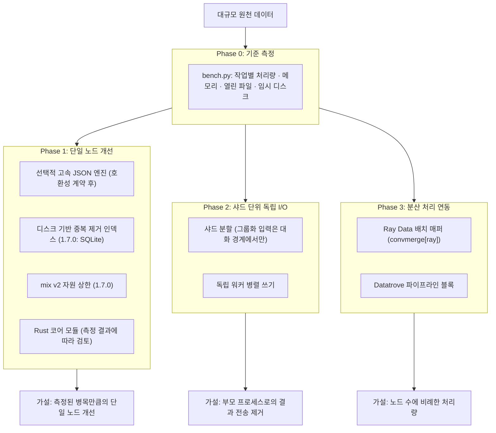
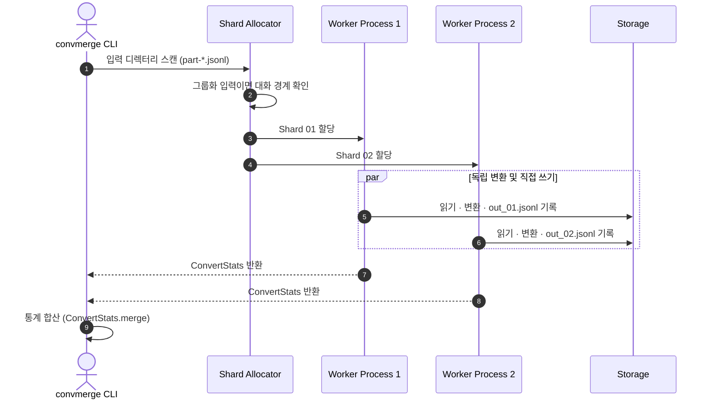

# convmerge 대규모 데이터셋 처리 및 분산 확장 전략

상태: **검토 반영본 (1.7.0)**. 초안을 이슈 #59–#64의 검토 의견에 맞춰 고쳤습니다.
1.7.0에서 구현한 항목은 [5. 단계별 실행 계획](#5-단계별-실행-계획)에 표시했습니다.
나머지는 설계이며, 수치는 아래 표기로 근거를 구분합니다.

| 표기 | 뜻 |
| :--- | :--- |
| **[측정]** | 이 저장소의 `benchmarks/bench.py`나 테스트로 측정한 값. 측정 조건은 [부록 A](#부록-a-기준-측정-170)에 있습니다. |
| **[인용]** | 외부 문서나 벤치마크에서 가져온 값. 이 저장소에서 재현하지 않았습니다. |
| **[가설]** | 아직 검증하지 않은 목표나 추정. 측정 전에는 우선순위의 근거로 쓰지 않습니다. |

본 문서는 `convmerge`가 수십 GB에서 TB급 LLM 데이터셋을 처리할 때 생길 수 있는
병목을 진단하고, 단일 머신 개선부터 분산 처리 연계까지 단계별 방안을 정의합니다.

---

## 1. 배경 및 문제 정의

`convmerge`는 단일 노드에서 가볍고 직관적으로 쓰도록 만들어졌습니다. 다만 수십 GB 이상의
데이터에서는 아래와 같은 한계가 예상됩니다. 이 저장소에서 측정한 최대 규모는 다음과 같으며
**[측정]**, 그보다 큰 규모의 처리 한계는 측정하지 않았습니다.

- 모든 벤치마크 명령: 소스당 200,000행(119 MB)
- `mix` 전체 병합: 소스당 110만 행(657 MB), 출력 330만 행
- `dedupe --near --seen-store sqlite`: 120만 행(706 MB)

### 핵심 병목 요인

1. **Python 인터프리터 및 GIL 제약**
   - 텍스트 정규화, 어댑터 파싱, 필터링 같은 CPU 연산이 Python 바이트코드로 실행됩니다.
   - 현재 `--workers N`은 프로세스 병렬로 이 제약을 우회합니다. `convert` 기준
     4 워커에서 2.5배 빨라졌습니다 **[측정]**.
2. **IPC 및 단일 쓰기 경로**
   - [`src/convmerge/_parallel.py`](../../src/convmerge/_parallel.py)의 멀티프로세싱 모델은
     청크를 부모와 자식 프로세스 사이에서 pickle로 주고받습니다.
   - 변환 결과는 부모 프로세스 하나가 순서대로 기록합니다
     ([`convert.py`의 `_run_parallel`](../../src/convmerge/convert.py)).
   - 이 경로가 전체 시간에서 차지하는 비율은 아직 측정하지 않았습니다 **[가설]**.
     [3.0](#30-기준-측정-64)의 다음 측정 항목에 포함합니다.
3. **메모리에 쌓이는 상태와 OOM 위험**
   - MinHash 근사 중복 제거([`near_dedup.py`](../../src/convmerge/normalize/near_dedup.py))는
     남긴 행마다 LSH band 키를 보관합니다. 기본 설정에서 행당 약 0.7 KB입니다 **[측정]**
     ([docs/quality.md](../quality.md)).
     1.7.0부터 `--seen-store sqlite`로 이 상태를 디스크에 둘 수 있습니다([3.1.3](#313-디스크-기반-근사-중복-제거-60)).
   - 믹싱([`mix.py`](../../src/convmerge/mix.py))의 v2 샘플러는 0.7부터 소스를 메모리에 올리지 않고
     스트리밍합니다(#24). 남은 자원 상한은 [3.1.4](#314-mix-v2의-자원-상한-63)에 정리했습니다.
4. **수평 확장 부재**
   - 단일 머신의 RAM, CPU, 디스크 I/O를 넘는 데이터를 여러 노드로 나눠 처리하는
     오케스트레이션이 없습니다.

---

## 2. 전체 아키텍처 로드맵

측정을 먼저 하고, 측정 결과에 따라 이후 단계의 우선순위를 정합니다(#64).
그림의 결과 칸은 모두 **[가설]**입니다.



---

## 3. 세부 해결 방안

### 3.0 기준 측정 (#64)

로드맵의 다른 항목보다 먼저 합니다. `benchmarks/bench.py`는 시나리오마다 새 프로세스에서
CLI를 실행해 벽시계 시간과 최대 RSS를 잽니다. `--json`을 주면 측정 조건(Python,
플랫폼, CPU 수, 입력 크기)도 함께 저장합니다. 1.7.0의 측정 결과는
[부록 A](#부록-a-기준-측정-170)에 있습니다.

아직 측정하지 않은 항목은 다음 단계에서 같은 스크립트에 추가합니다.

- 단계별 시간 분해: 파싱, 어댑터·검증, 직렬화, IPC(pickle), 디스크 쓰기.
- 워커 전체 메모리. 지금의 최대 RSS는 부모 프로세스만 셉니다.
- 열린 파일 수의 최댓값과 임시 디스크 사용량의 최댓값.
- 행 길이 분포(짧은 행·긴 행), 중복률·오류율, 워커 수(1/2/4/8), 캐시 상태(첫 실행·재실행).
- 결과 동등성: 모든 시나리오에서 출력 해시를 기록합니다.

> **Amdahl의 법칙에 따른 상한.** 전체 시간의 비율 p인 부분을 s배 빠르게 하면
> 전체 속도는 1 / ((1 − p) + p / s)배가 됩니다. 초안의 가정대로 JSON 처리가 50%이고
> 이를 4–8배 빠르게 하면, 전체는 약 1.6–1.8배입니다. 따라서 "JSON 4–8배"는
> "단일 머신 처리량 5–10배"의 근거가 될 수 없습니다. 실제 p는 위 시간 분해로
> 측정한 뒤 판단합니다.

### 3.1 방안 1: 단일 노드 개선

> **목적**: 별도의 클러스터 없이 단일 머신에서 더 큰 데이터를 처리합니다.

#### 3.1.1 고속 JSON 엔진 (`orjson`) — 호환성 계약 먼저 (#61)

엔진을 넣기 전에, 어떤 입력을 받아들이고 무엇을 출력하는지를 먼저 고정합니다.
선택적 의존성을 설치했는지에 따라 유효 입력, 탈락 행, 숫자 값, 출력 바이트가
달라지면 안 되기 때문입니다.

**현재 파서.** 현재 파서는 [`io._loads` / `io._parse_line`](../../src/convmerge/io.py)입니다.
표준 라이브러리의 C 스캐너를 직접 호출하고, 받아들이지 못하는 경우만 `json.loads`로 넘깁니다.
그래서 결과와 오류 메시지는 `json.loads`와 같고, Python 계층의 오버헤드(파싱 시간의
약 1/3)는 건너뜁니다. 이 C 스캐너 경로가 모든 성능 비교의 기준선입니다.

**호환성 표.** 표준 라이브러리 값은 `tests/test_io.py::test_json_semantics_baseline`으로
고정했습니다. orjson 값은 orjson 3.13.0으로 측정했습니다 **[측정]**.

| 입력 | 현재 (표준 라이브러리) | orjson 3.13.0 | 차이 |
| :--- | :--- | :--- | :--- |
| `NaN`, `Infinity`, `-Infinity` | 받아들임 (float) | 오류 | 탈락 행이 늘어남 |
| `1e400` (double 범위 초과) | 받아들임 (`inf`) | 오류 | 탈락 행이 늘어남 |
| `18446744073709551616` (2**64) | 정확한 `int` | **오류 없이 float로 바뀜** (`1.8446744073709552e+19`) | 값이 조용히 바뀜 |
| `9223372036854775808` (2**63) | `int` | `int` | 같음 |
| 짝 없는 서로게이트 `"\ud800"` | 탈락 (convmerge 자체 검사) | 오류 | 같음 (둘 다 탈락) |
| 줄 앞뒤 공백 | 받아들임 | 받아들임 | 같음 |
| 파일 중간 줄의 BOM | 탈락 | 오류 | 같음 (둘 다 탈락) |
| 중복 키 | 마지막 값 | 마지막 값 | 같음 |
| 중첩 깊이 | convmerge가 500에서 제한 | 1024에서 제한, 500은 통과 | convmerge 검사가 그대로 적용됨 |
| 잘못된 바이트 | 읽을 때 검사 (convmerge) | 해당 없음 (str 입력) | 같음 |

| 직렬화 | 현재 `json.dumps(ensure_ascii=False)` | `orjson.dumps` | 차이 |
| :--- | :--- | :--- | :--- |
| 구분자 | `", "` 와 `": "` | 공백 없음 | **출력 바이트가 다름** |
| `NaN` | `NaN` | `null` | 값이 바뀜 |
| 2**64 이상 정수 | 그대로 | 오류 | 실패 |
| 반환 타입 | `str` | UTF-8 `bytes` | 쓰기 경로 변경 필요 |

**계약.**

1. **기본 동작은 그대로입니다.** orjson이 설치돼 있어도 기본 엔진은 표준 라이브러리입니다.
   빠른 엔진은 `--json-engine orjson`처럼 명시적으로 선택해야 합니다. 설치 여부만으로
   결과가 바뀌면 안 됩니다.
2. **파싱:** 빠른 엔진이 거부한 줄은 표준 라이브러리로 다시 파싱합니다. 그러면 유효 입력과
   탈락 통계가 그대로 유지됩니다. 단, 2**64 이상 정수는 orjson이 오류 없이 float로
   바꾸므로, 줄 단위 폴백만으로는 동등성을 보장할 수 없습니다. 부호를 뺀 자릿수가 20자리
   이상인 정수 토큰이 있는 줄(64비트 범위를 넘을 수 있는 값)도 표준 라이브러리로 보내야
   하며, 이 검사 비용까지 포함해 측정합니다.
3. **직렬화:** 출력은 **바이트 동등성**을 보장합니다(같은 입력과 seed면 같은 바이트).
   orjson의 출력은 구분자와 NaN 처리가 다르므로, 변환 결과의 직렬화는 표준 라이브러리로
   유지합니다. `dedupe`, `filter`, `mix`는 원본 줄을 그대로 쓰기 때문에 영향이 없습니다.
4. **검증:** 엔진을 구현할 때는 지원하는 모든 입력에 대해 두 엔진의 변환 결과(바이트)와
   `ConvertStats`가 같은지 비교하는 테스트를 넣습니다. 위 기준선 테스트도 그대로
   통과해야 합니다.

초안의 "JSON 처리 4–8배"에는 출처가 없습니다. orjson 저장소는 표준 라이브러리와 비교한
자체 벤치마크를 싣고 있지만 **[인용]**, 행 모양과 크기에 따라 결과가 다릅니다.
convmerge 파이프라인에서의 효과는 측정 전이며 **[가설]**, 3.0의 시간 분해로 확인합니다.

#### 3.1.2 Rust 코어 엔진 (PyO3 / maturin) — 측정 후 검토

- 텍스트 정규화, 어댑터 파싱, MinHash 계산을 Rust로 옮기고, GIL 밖에서 멀티스레드로
  실행하는 안입니다 **[가설]**.
- 배포 비용(플랫폼별 휠, 빌드 체인)이 크므로, 3.0에서 해당 구간이 실제 병목으로 측정될
  때만 착수합니다. 현재 `--workers`가 이미 CPU 병렬을 제공한다는 점도 비교 기준에 넣습니다.

#### 3.1.3 디스크 기반 근사 중복 제거 (#60)

> 초안의 "청크별 임시 디스크 플러시"만으로는 메모리와 정확성을 함께 해결할 수 없습니다.
> 플러시한 뒤 메모리 집합만 비우면 이전 청크와의 중복을 놓칩니다. 집합을 비우지 않으면
> 메모리는 그대로 늘어납니다. 필요한 것은 **메모리와 디스크에 나뉜 전체 band 키에 대한
> 조회·삽입 계약**입니다.

**1.7.0 구현.** `dedupe --near --seen-store sqlite`
(`deduplicate_near_jsonl(seen_store="sqlite", seen_db=...)`)

- **조회 계약:** 행마다 band 키 전체를 SQLite 테이블(`near_bands`, 정수 기본 키)에서
  찾습니다. 하나라도 있으면 중복으로 탈락시키고, 없으면 그 행의 키를 모두 넣습니다.
  메모리 집합과 같은 판정이며, 페이지 캐시 밖으로 나간 키도 그대로 조회됩니다.
  "플러시"가 판정에 영향을 주지 않습니다.
- **대표 레코드:** 입력 순서상 먼저 남긴 행이 대표입니다(기존 알고리즘과 같음).
  외부 정렬을 쓰지 않으므로 대표 선택이 바뀌지 않습니다.
- **동등성 검증:** `tests/test_near_dedup.py::test_sqlite_store_matches_memory`에서 확인합니다.
  - `--workers` 1과 3, 청크 크기 7행, 페이지 캐시 16 KiB(디스크로 여러 번 내보내짐)
  - 정방향 입력과 역방향 입력(대표 선택이 바뀌는 경우)
  - 메모리 저장소와 출력·rejects·통계가 바이트 단위로 같고, datasketch `MinHashLSH`
    기준 구현과도 같음
- **메모리 예산:** SQLite 페이지 캐시 64 MiB와 처리 중인 청크입니다. 남긴 행 수에 비례해
  늘어나지 않습니다. 고유 행 입력에서 측정한 최대 RSS는 다음과 같습니다 **[측정]**.
  - SQLite 저장소: 20만 행 115 MB, 60만 행 160 MB, 120만 행 161 MB.
    DB가 캐시보다 커진 뒤로는 그대로입니다.
  - 메모리 저장소: 20만 행 232 MB, 60만 행 690 MB. 최대 RSS 기준으로 남긴 행당 약 1.1 KB씩
    늘어납니다. 인덱스 자체는 행당 약 0.7 KB이고, 나머지는 `set` 확장 중의 일시적 사용량으로 보입니다 **[가설]**.
- **디스크 사용량:** 기본 설정에서 남긴 행당 약 140 B입니다(고유 행 20만 개에서 28 MB) **[측정]**.
  기본 임시 파일은 시스템 임시 디렉터리에 만들어집니다. 그 디렉터리가 tmpfs(메모리)면
  `--seen-db`로 디스크 경로를 지정해야 합니다.
- **생명주기:** `--seen-db`가 없으면 임시 파일(`convmerge-near-*.sqlite`)을 만들고,
  성공했을 때와 예외가 났을 때(공간 부족 포함) 모두 지웁니다. 이는 테스트로 확인했습니다.
  프로세스가 강제 종료되면(SIGKILL) 파일이 남을 수 있습니다.
  `--seen-db PATH`를 주면 파일을 남기며, 그 안에 이미 있는 키는 본 것으로 칩니다.
  이를 이용해 이전 실행 결과와 비교하는 중복 제거가 가능합니다.
- **비용:** 메모리 저장소보다 19–25% 느립니다(20만 행 77초 → 91초, 60만 행 243초 → 303초)
  **[측정]**. 120만 행(579초)까지 행 수에 비례해 늘었습니다.

**다음 단계 (미구현).**

- 수억 행: SQLite B-tree의 무작위 조회가 병목이 될 수 있습니다 **[가설]**.
  대안은 band별 외부 정렬과 병합입니다. 하지만 정렬 기반은 "먼저 남긴 행"이라는 순차
  조건을 지키기 어렵습니다. 후보 쌍을 찾은 뒤 입력 순서대로 다시 판정하는 2단계가
  필요합니다.
- 분산 근사 중복 제거는 전역 인덱스 공유가 필요하므로 Phase 3에서
  band별 정렬 후 클러스터링하는 방식을 검토합니다.

#### 3.1.4 mix v2의 자원 상한 (#63)

v2 샘플러는 소스를 두 번 스트리밍합니다. 1회차에서 유효한 줄을 세고, 2회차에서 고른
줄을 무작위 버킷 파일에 나눈 뒤 버킷별로 섞어 출력합니다. 입력 전체를 메모리에
올리지 않는 것은 #24에서 해결됐습니다. 남은 자원 사용은 아래와 같습니다.

| 자원 | 1.6.5 | 1.7.0 | 상한 정책 |
| :--- | :--- | :--- | :--- |
| 고른 줄 / 건너뛴 줄 번호 (`_plan`) | `frozenset`, 항목당 약 66 B | 정렬된 `array('q')`, 항목당 8 B | 샘플 크기에 비례합니다. 소스 행 수의 절반을 넘지 않습니다(작은 쪽을 기억). |
| 읽을 수 없는 줄 번호 (`_scan`) | `frozenset` | `array('q')`, 항목당 8 B | 오류 행 수에 비례합니다. 오류 1억 행이면 800 MB입니다. 실패 정책은 두지 않고 문서로 명시합니다. |
| 동시에 열린 버킷 파일 | 버킷 수 전부 (출력 25,000행당 1개) | **최대 128개** | 버킷이 128개 이하(출력 320만 행 이하)면 1.6.5와 같습니다. 그보다 많으면 연속된 버킷 여러 개가 한 파일을 함께 쓰고(줄마다 버킷 번호 태그), 출력할 때 단계적으로 나눕니다. |
| 쓰기 버퍼 | 파일 객체 버퍼 × 버킷 수 | 파일 객체 버퍼 × 128 이하 | 약 1 MB 이하 |
| 버킷 셔플 | 버킷 하나(25,000행)를 `readlines()`로 읽음 | 같음 | **남은 제한:** 행 길이에 비례합니다(25,000 × 평균 행 길이). |
| 임시 디스크 | 버킷 ≈ 출력 크기. 출력이 끝날 때까지 남음 | 읽은 버킷을 바로 지움 | 출력 디렉터리에 출력 크기의 약 1배와 공유 파일 하나를 나누는 여유, 그리고 기존 출력이 필요합니다. 1.6.5는 약 2배가 필요했습니다. |

- **열린 파일 수:** 1.6.5는 버킷 수가 열린 파일 한도를 넘으면 "Too many open files"로
  실패했습니다. 한도가 1,024인 Linux에서는 출력이 약 2,500만 행을 넘을 때, 기본 한도가
  256인 macOS에서는 약 600만 행을 넘을 때입니다. 1.7.0은 같은 조건에서 통과합니다
  (`tests/test_mix.py::test_v2_many_buckets_under_a_low_open_file_limit`).
- **공유 파일의 비용:** 버킷이 128개를 넘으면 데이터를 더 쓰고 읽습니다.
  추가 횟수는 ⌈log₁₂₈(버킷 수)⌉ − 1이며, 출력 4억 행(16,384 버킷)까지는 한 번입니다. 측정 결과는 [부록 A](#부록-a-기준-측정-170)에 있습니다.
- **정리 동작:** 버킷은 출력 옆의 `.convmerge-mix-*` 임시 디렉터리에 만들어집니다.
  성공했을 때와 예외(공간 부족 포함)가 났을 때 모두 지워지고, 기존 출력은 바뀌지 않습니다
  (`test_v2_failure_leaves_no_temp_files_or_output`, 쓰기 단계와 분할 단계 각각).
  읽은 버킷을 바로 지우는 동작은 `test_v2_buckets_free_disk_while_the_output_grows`로
  확인합니다. 강제 종료되면 디렉터리가 남을 수 있습니다.
- **재현성 계약:** 같은 입력, seed, 가중치, clipping, oversampling, recipe면 출력 바이트가
  같아야 합니다. 1.7.0의 변경은 난수 호출 순서와 버킷 배정을 바꾸지 않습니다.
  - 1.6.5 출력 해시를 테스트에 고정했습니다. 열린 파일 상한이 2, 3, 기본값일 때 모두 같습니다.
    상한이 2이면 여러 단계로 나뉘고, 버킷 하나만 남은 공유 파일도 생깁니다.
  - 배포 전에는 다음 조합 216가지의 출력을 1.6.5와 비교해 모두 같음을 확인했습니다.
    - 6개 시나리오: 일부 선택, 대부분 선택, 여러 소스, oversampling, 전체 병합, `--by chars`
    - 3개 seed, 3개 버킷 크기
    - 4개 열린 파일 상한: 128, 2, 3, 5
- **남은 제한 — 바이트 기준 버킷 (미구현).** 버킷을 행 수가 아닌 바이트로 나누면 긴 행에서도
  셔플 메모리가 일정해집니다. 하지만 버킷 배정이 바뀌어 같은 seed의 출력이 달라집니다.
  따라서 새 샘플러 버전(`--sampler v3`)으로만 도입하고, v2는 현재 출력을 계속 재현합니다.
  `.mix.json`과 recipe 잠금에는 이미 샘플러 버전이 기록됩니다.

---

### 3.2 방안 2: 샤드 단위 독립 I/O (Sharded Independent I/O)

> **목적**: 결과를 부모 프로세스로 보내는 비용과 단일 쓰기 경로를 없앱니다.



1. **샤드 파일 입출력** (`part-00000.jsonl.zst` / `.parquet`)
2. **독립 워커**: 각 워커가 자기 샤드를 읽고 자기 출력 파일에 씁니다.
   부모로 보내는 것은 통계뿐입니다.
   - 이는 "결과를 부모로 보내는 IPC가 없다"는 뜻일 뿐, 파이프라인 전체에서 복사가
     없다는(zero-copy) 뜻은 아닙니다. 각 워커는 여전히 읽기, 디코딩, 파싱, 직렬화를 합니다.
     실제로 얼마나 줄어드는지는 3.0의 시간 분해로 확인합니다 **[가설]**.

#### 3.2.1 처리 단위 계약 (#59)

입력은 두 종류입니다.

| 입력 | 처리 단위 | 샤드·배치 분할 조건 |
| :--- | :--- | :--- |
| 독립 행 (Alpaca, ShareGPT, messages, 트리 형식 OpenAssistant 등) | 행 | 어디서 잘라도 됩니다. |
| **그룹화 행** (OpenAssistant 메시지 행: `message_tree_id`, `message_id`, `parent_id`, `role`) | **같은 `message_tree_id`가 연속된 행 묶음** (하나의 대화 트리) | **트리 사이에서만** 자를 수 있습니다. |

- **현재 동작 (단일 처리):** `convert_file`은 그룹화 행을 발견하면 `--workers`를 1로
  낮춥니다([`convert.py`](../../src/convmerge/convert.py)의 `_groups_rows`).
  `convert_records`는 한 번의 호출 안에서 연속된 행을 하나의 트리로 묶습니다.
  같은 트리라도 행이 떨어져 있으면 단일 처리에서도 별개의 단위입니다(`test_trees_group_by_consecutive_rows`).
- **경계가 트리 안에 걸리면:** 조각마다 따로 변환됩니다. 답변이 없거나 루트가 없는 조각은
  출력되지 않고, `ConvertStats.dropped`(예: `missing_root`)로 집계됩니다. 조용히
  사라지지는 않지만, 단일 처리와 결과가 다릅니다(`test_a_batch_split_inside_a_tree_is_counted_not_lost`).
- **계약:**
  1. 샤드 할당기는 그룹화 입력을 트리 경계에서만 자릅니다. 경계를 정할 수 없는 경우에는
     **명시적으로 거부**하고(종료 코드 2), 조각 단위 변환으로 넘어가지 않습니다.
     예를 들어 이미 나뉘어 있는 `part-*` 파일에서 앞 샤드의 마지막 트리가 다음 샤드로
     이어지는 경우입니다.
  2. 감지 조건은 다음과 같습니다. 샤드의 첫 행이 이전 샤드 마지막 행과 같은
     `message_tree_id`의 메시지 행이면 경계가 트리 안에 있는 것입니다.
- **출력 순서:** 샤드 출력을 입력 순서대로 이어 붙이면 단일 처리의 출력과 같습니다.
  `--output-dir`처럼 샤드별 출력을 남기는 모드에서는 `out_NNNNN`의 번호가 입력 순서를
  보존합니다.
- **통계 합산:** `ConvertStats.merge`로 필드마다 더합니다.
  - 트리 경계로 자른 배치들의 합은 단일 처리와 같습니다(`test_batches_cut_between_trees_match_one_pass`).
  - 단, `drop_lines`와 `first_invalid_line`의 줄 번호는 샤드 기준입니다. 합칠 때
    샤드 시작 오프셋을 더하거나, (샤드, 줄) 쌍으로 보고해야 합니다.

### 3.3 방안 3: 분산 처리 프레임워크 연계

> **목적**: 클러스터에서 단일 머신을 넘는 데이터를 병렬 처리합니다. 처리 가능 규모는
> 구현하고 측정하기 전까지 **[가설]**입니다.

#### 3.3.1 Ray Data 배치 매퍼 (`convmerge[ray]`) (#62)

> **설계 예시입니다.** `convmerge.integrations.ray.ConvmergeBatchMapper`는 아직 없으며,
> 아래 코드는 지금 실행되지 않습니다.

- **적용 이유:** Spark보다 Python 생태계(Hugging Face, PyTorch)와 잘 맞고, Arrow 배치를
  그대로 주고받습니다.
- **연계 방식:** 매퍼는 배치마다 기존 [`convert_records`](../../src/convmerge/convert.py)를
  호출하는 callable class로 만듭니다. 액터 풀(`ActorPoolStrategy`)을 쓰려면
  **클래스 자체**를 넘기고 생성자 인자는 `fn_constructor_kwargs`로 전달해야 합니다.
  초안처럼 이미 만든 인스턴스를 넘기면 Ray가 거부합니다.

```python
import ray
from convmerge.integrations.ray import ConvmergeBatchMapper  # 아직 없음 (설계 예시)

ds = ray.data.read_json("s3://llm-dataset-bucket/raw/*.jsonl")

transformed_ds = ds.map_batches(
    ConvmergeBatchMapper,  # 인스턴스가 아니라 클래스
    fn_constructor_kwargs={
        "adapter": "sharegpt",
        "output_format": "messages",
    },
    batch_format="pyarrow",
    # 로컬 예제: CPU 수 이하로. 클러스터에서는 노드·CPU 수에 맞춥니다.
    compute=ray.data.ActorPoolStrategy(min_size=1, max_size=4),
)

transformed_ds.write_parquet("s3://llm-dataset-bucket/processed/")
```

- **대상 버전과 의존성:** Ray 2.x의 `Dataset.map_batches`(`fn_constructor_kwargs`,
  `compute=ActorPoolStrategy`)를 기준으로 합니다. 최신 Ray에서는 액터 수를
  `concurrency=(min, max)`로 지정하는 방식이 권장될 수 있으므로, 매퍼를 구현할 때 지원
  최소 버전을 고정하고 `convmerge[ray]` extra에 반영합니다. 필요한 패키지는 `ray[data]`와
  `pyarrow`입니다.
- **자원:** `min_size`만큼 액터가 동시에 떠 있어야 합니다. 각 액터는 기본적으로 CPU 1개를
  씁니다. 초안의 `min_size=8`은 8 CPU 미만 환경에서 대기 상태가 되므로, 예제는 로컬에서
  돌아가는 값으로 바꿨습니다.
- **그룹화 입력:** Ray는 배치를 행 수로 나누므로 3.2.1의 계약을 지킬 수 없습니다.
  매퍼는 OpenAssistant 메시지 행을 발견하면 거부해야 합니다. 이 경우 미리 트리 형식
  (`*.trees.jsonl`)으로 바꾸거나 `message_tree_id` 기준으로 groupby한 뒤 넘기도록 안내합니다.
- **구현 시 검증:** 로컬 Ray(`ray.init(num_cpus=2)`)와 작은 데이터셋으로 아래를 확인합니다.
  - 생성자 인자가 전달되는지
  - 배치 변환 결과가 `convert_records` 단일 호출과 같은지
  - 출력 쓰기가 되는지
  - 그룹화 입력이 거부되는지

#### 3.3.2 Hugging Face Datatrove 파이프라인 블록

- **적용 이유:** 대규모 LLM 데이터 파이프라인에서 널리 쓰이고, Slurm과 로컬 실행을 지원합니다.
- **연계 방식:** `datatrove.pipeline.base.PipelineStep`을 상속한 `ConvmergeTransformBlock`을
  제공합니다 **[가설, 미구현]**. 그룹화 입력에는 3.3.1과 같은 제약이 적용됩니다.

---

## 4. 기술 대안 비교 매트릭스

"검증된 규모"는 이 저장소에서 측정한 규모이고, "목표 규모"는 **[가설]**입니다.

| 접근 방식 | 검증된 규모 | 목표 규모 | 구현 난이도 | 외부 의존성 / 인프라 | 주요 장점 |
| :--- | :--- | :--- | :--- | :--- | :--- |
| **현재 상태 (순수 Python)** | 명령 전체: 소스당 20만 행(119 MB). `mix` 병합: 소스당 110만 행(657 MB). 근사 중복 제거: 120만 행(706 MB) | 수십 GB (측정 필요) | - | 없음 | 가볍고 즉시 실행 가능 |
| **고속 파서 (선택)** | - | 3.0 측정 후 결정 | 중간 | `orjson` | 파싱 구간 단축 (전체 효과는 Amdahl 상한 이하) |
| **Rust 코어** | - | 3.0 측정 후 결정 | 높음 | 플랫폼별 휠 | GIL 없는 CPU 병렬 |
| **샤드 I/O** | - | 수백 GB | 낮음~중간 | 없음 | 결과 전송·단일 쓰기 제거 |
| **Ray Data 연동** | - | 수 TB 이상 | 중간 | Ray 클러스터 | 노드 단위 확장, 오브젝트 스토리지 직접 연동 |
| **Datatrove 연동** | - | 수 TB 이상 | 낮음 | `datatrove`, Slurm/Ray | 기존 파이프라인과의 결합 |

---

## 5. 단계별 실행 계획

> 코어는 의존성 없이 가볍게 유지하고, 대용량 기능은 선택적 확장(`extras`)으로 제공합니다.

### 1단계: 측정과 자원 상한 (v1.7)

- [x] 근사 중복 제거의 디스크 기반 전역 인덱스: `--seen-store sqlite` (#60)
- [x] mix v2의 열린 파일 수 상한, 줄 번호 인덱스 압축, 임시 디스크와 정리 정책 문서화 (#63)
- [x] OpenAssistant 메시지 행의 샤드·배치 계약과 회귀 테스트 (#59)
- [x] JSON 엔진 호환성 표와 표준 라이브러리 기준선 테스트 (#61)
- [x] Ray 예제 수정과 설계 예시 표시 (#62)
- [x] 기준 벤치마크와 측정 조건 기록 (#64)

### 2단계: 측정 기반 개선 (v1.8 ~ v2.0)

- [ ] 단계별 시간 분해, 워커 전체 메모리, 열린 파일·임시 디스크 최댓값 측정 추가 (3.0)
- [ ] 3.1.1 계약에 따른 선택적 `orjson` 파싱 (`convmerge[fast]`, 명시적 선택, 결과 동등성 테스트)
- [ ] 디렉터리 입력과 샤드별 독립 쓰기 (`--output-dir`), 그룹화 입력의 경계 검사 포함 (3.2.1)
- [ ] mix `--sampler v3`: 바이트 기준 버킷 (3.1.4)
- [ ] Arrow/Parquet 스트리밍 읽기·쓰기 강화
- [ ] 측정 결과에 따라 Rust 모듈 검토

### 3단계: 분산 연동 (v2.1+)

- [ ] `convmerge[ray]` 배치 매퍼와 실행 가능한 예제 (3.3.1의 검증 항목 포함)
- [ ] `datatrove` 파이프라인 블록

---

## 부록 A. 기준 측정 (1.7.0)

**조건.**
- 장비: 4코어 컨테이너(Intel Xeon 2.10 GHz), RAM 15 GB
- 소프트웨어: Linux 6.18, Python 3.13.17
- 실행: 시나리오마다 한 번씩, 새 프로세스에서 실행(반복 측정과 분산은 없음).
  최대 RSS는 부모 프로세스 기준이며 워커는 포함하지 않습니다.
- 입력: 합성 데이터
  - 일반 소스: 소스당 200,000행 119 MB(1–3턴 채팅, 행당 약 600 B)
  - 근사 중복 제거 입력: 무작위 단어 117 MB. 중복이 없어 모든 행이 인덱스에 들어가는 최악의 경우입니다.
- 명령: `PYTHONPATH=src python benchmarks/bench.py --rows 200000 --json out.json`.
  1.6.5는 같은 스크립트로 `main` 체크아웃의 `src`를 가리켜 측정했습니다.

| 시나리오 | 1.6.5 | 1.7.0 |
| :--- | :--- | :--- |
| `convert` | 10.6 s / 23 MB | 10.3 s / 23 MB |
| `convert --workers 4` | 4.3 s / 59 MB | 4.0 s / 60 MB |
| `dedupe` | 4.5 s / 48 MB | 3.8 s / 48 MB |
| `dedupe --seen-store sqlite` | 5.0 s / 28 MB | 4.5 s / 27 MB |
| `dedupe --near` | 73.2 s / 232 MB | 76.6 s / 232 MB |
| `dedupe --near --seen-store sqlite` | 없음 | 91.0 s / 115 MB |
| `filter` | 측정 안 함 | 11.7 s / 23 MB |
| `filter --workers 4` | 측정 안 함 | 3.2 s / 60 MB |
| `mix --total 20000` | 4.0 s / 38 MB | 4.3 s / 36 MB |
| `mix` 전체 병합 | 11.1 s / 39 MB | 8.7 s / 39 MB |
| `mix` 전체 병합, 소스당 110만 행 (출력 330만 행, 버킷 132개) | 69.5 s / 40 MB | 61.1 s / 40 MB |
| `dedupe --near`, 60만 행 | 측정 안 함 | 243.2 s / 690 MB |
| `dedupe --near --seen-store sqlite`, 60만 행 | 없음 | 302.7 s / 160 MB |
| `dedupe --near --seen-store sqlite`, 120만 행 | 없음 | 579.0 s / 161 MB |

**결과 동등성.**
- `mix`: 1.6.5와 1.7.0의 출력이 같음을 216개 조합에서 확인했습니다(3.1.4).
- 근사 중복 제거: 두 저장소의 출력이 같음을 테스트로 확인했습니다(3.1.3).

**읽는 법.**
- 한 번씩만 잰 값이므로, 두 버전의 차이가 10% 안쪽이면 측정 오차와 구분되지 않습니다.
  예를 들어 `mix` 병합이 빨라진 것처럼 보이지만, 개선으로 주장하지 않습니다.
- 다음 측정 항목(시간 분해, 워커 전체 메모리, 열린 파일·임시 디스크 최댓값, 반복 측정)은
  3.0에 정리했습니다.

## 부록 B. 이슈 대응표

| 이슈 | 다룬 곳 | 1.7.0의 코드·테스트 |
| :--- | :--- | :--- |
| #59 샤드·배치 경계의 OpenAssistant 대화 | 3.2.1, 3.3.1 | `convert_records` 문서, `tests/test_trees_and_scores.py`의 경계 테스트 3개 |
| #60 근사 중복 제거의 전역 판정 | 3.1.3 | `--seen-store sqlite`, `tests/test_near_dedup.py`의 저장소 테스트 4개 |
| #61 orjson 호환성 계약 | 3.1.1 | `tests/test_io.py::test_json_semantics_baseline` |
| #62 Ray 예제 | 3.3.1 | (문서만, 매퍼 미구현) |
| #63 mix v2 자원 상한 | 3.1.4 | `mix.py`의 `_Buckets`·정렬 배열, `tests/test_mix.py`의 재현성·fd·정리 테스트 |
| #64 기준 벤치마크 | 3.0, 부록 A | `benchmarks/bench.py` 시나리오·측정 조건 추가 |
